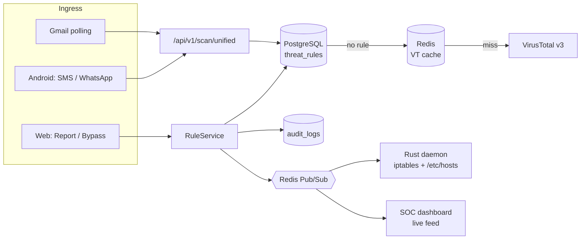

# Obsidian

**One threat-rule engine for email, messaging and the network, for consumers and organizations.**

When someone reports a phishing link from a phone, Obsidian blocks it on every machine in the organization in under a second.

> **Status:** hackathon project, in progress. See [Current status](#current-status) for the implementation snapshot, [`TODO.md`](TODO.md) for open work, and [`docs/protocol.md`](docs/protocol.md) for the shared API and WebSocket contract.

---

## Current status

| Component | State |
| --- | --- |
| Repo scaffolding | Done: `db/init.sql`, `docker-compose.yml`, `.env.example`, `docs/protocol.md` (the shared contract), `cloudflared/config.yml`, `scripts/` (seed, VirusTotal pre-warm, demo reset). |
| `backend-spring/` auth | Done: Argon2id password login, passkeys (Spring WebAuthn, JDBC tables), `__Host-session` cookie in Redis, CSRF cookie, mobile bearer tokens, Turnstile. The web session ends after the last dashboard tab closes. |
| `backend-spring/` rules | Done: `RulePrecedence`; `RuleService` saves, audits and publishes every change; `GET /rules`, `POST /rules/report`, `POST /rules/bypass`. |
| `backend-spring/` scanner | Done: `POST /scan/unified`, `GET /scans`, VirusTotal v3 (Redis cache, 4/min limiter, submit + poll, `PENDING`), topmost `mx.google.com` SPF/DKIM/DMARC, MIME links and attachment SHA-256. |
| `backend-spring/` Gmail | Done: OAuth connect (encrypted refresh token), polling worker, `GET /emails`, `/integrations/gmail`. Not yet tried against a real Google account. |
| `backend-spring/` WebSockets + agents | Done: `/ws/firewall` (bearer handshake, SYNC, BLOCK/BYPASS, HEARTBEAT), `/ws/dashboard`, Redis fan-out, `POST/GET /agents`. |
| `daemon-rust/` | Done: SYNC reconcile, BLOCK/BYPASS, 10 s heartbeat, reconnect, cleanup on SIGINT/SIGTERM, `--dry-run`. Verified end to end in dry-run against the backend; not yet run as root with real iptables. |
| `web-dashboard/` | Separate admin and employee workspaces after one sign-in. **Admins:** security overview, threat monitoring, email, messaging and endpoint security (with a per-host page showing the enforced block set), code security with a repository inventory, rules and policies, consumer reports, reports, an append-only audit log with record detail, and settings for integrations, the organization and users and roles (add members with a temporary password, change roles, remove). **Employees:** their own overview, threat events, email, messages, reports and settings; admin pages show a notice. Built from the Figma redesign, leaving out the screens nothing backs (binary analysis, investigations, PR review). Works in `live` mode against the backend through the Next.js rewrites; field names are checked by `ApiContractTest`. |
| Code Guard [P1] | Done: GitHub App webhook (HMAC-verified), gitleaks + OSV-Scanner on push and pull request with a Check Run, release assets → VirusTotal, the dashboard Code Guard page. Tested against a fake GitHub with stand-in scanners; needs a real GitHub App, the public tunnel and gitleaks + osv-scanner installed. |
| `mobile-android/` (B2C) | The consumer app, on its own API (`/api/b2c/v1`): sign-up with name, email and password verified by an emailed code (or Google), a required app lock (fingerprint when the phone has one, PIN always), and four tabs: **Home** (protection checklist, link and file checks, server and database status, alerts bell), **Activity** (grouped by threat, status or score, with a report panel), **Firewall** (a DNS-only local VPN with blacklist/whitelist and an outgoing/incoming request log) and **Settings** (default browser defense, notification auditor, lock, server address, six themes, account). Checked end to end on the Android 17 emulator; Google sign-in, real SMTP and physical devices are still open in [`TODO.md`](TODO.md). |
| `backend-spring/` B2C | Done: `/api/b2c/v1` on its own stateless filter chain with `obc_` tokens and separate `consumers`, email codes over SMTP, Google ID token sign-in, scans with personal → shared → VirusTotal precedence, Activity, personal rules, the phone firewall's blocklist, and consumer reports that become global blocks when VirusTotal flags them, 3 verified consumers report them, or an admin approves them (never for a protected domain). The dashboard's **Consumer Reports** page is the admin queue. |

Tests: backend 278/278 (`cd backend-spring && gradle test`, on embedded PostgreSQL 16 and an in-process Redis, so no Docker is needed), daemon 19/19 (`cargo test`), Android 24/24 (`./gradlew testDebugUnitTest`).

### What is next

The active P0 and gated P1 items are tracked in [`TODO.md`](TODO.md). The immediate goal is to verify real firewall enforcement, then a consumer report from the Android app reaching the daemon.

---

## Problem Statement

Phishing and scam campaigns don't stick to one channel. The same malicious domain arrives by email, then by SMS, then in a WhatsApp message, and eventually a laptop on the corporate network tries to connect to it. Defenses are still built one channel at a time:

- **The channels don't share what they learn.** An email filter that flags a domain doesn't tell the phone's messaging app, and neither of them tells the network firewall. Whoever spots a threat first can't protect anyone else.
- **Users who spot threats have nowhere to send them.** When a phishing email gets past the filter, the user who notices it usually has no one-click way to report it, and reporting it doesn't protect their colleagues.
- **Consumers are mostly unprotected outside email.** Smishing and WhatsApp scams reach people who have no security team. They are especially effective from unknown numbers, or from familiar contacts whose accounts were compromised.
- **Code is a channel too.** API keys get committed in plain text, vulnerable dependencies ship unnoticed, and a release binary can carry malware. Teams rarely connect these signals to the rest of their defenses.
- **Bypassing a block is all or nothing.** False positives are common. Blocks that are rigid get disabled wholesale, and overrides that never expire stay open forever.
- **Authentication is still often just a password.** The dashboard that controls an organization's firewall should not be protected by a reusable password alone.

**Problem:** Build a platform that treats email, SMS/WhatsApp and network traffic as **one surface with one rule set**. A threat seen once, by any user on any channel, should be blocked everywhere in real time. The platform should stay usable for non-technical consumers, give security teams central control with audit trails, and resist account takeover.

### Who it's for

| | Consumers (B2C) | Organizations (B2B) |
| --- | --- | --- |
| **Who** | Everyday people with an Android phone and a Gmail account | Companies running a small SOC or IT team |
| **Pain** | Scam texts, WhatsApp phishing, spam they can't judge | Per-channel tools, reports that don't spread, unaudited overrides |
| **Need** | Zero-jargon warnings, 1-tap report/trust | One report blocks for everyone, time-limited bypass, OS-level enforcement |

### What success looks like

1. A link reported from a phone is enforced at the OS firewall of an enrolled laptop in **under a second**.
2. Legitimate, cryptographically verified email passes through **untouched**.
3. An unverified verdict is never shown as "safe". Unknown means `PENDING`.
4. Every rule change is **audited**, and enterprise bypasses **expire** automatically.
5. Sign-in uses **passkeys** (FIDO2). Passwords are only a fallback, hashed with Argon2id.

---

## How It Works



1. **Ingest:** messages arrive from Gmail (OAuth polling), Android notifications (SMS and WhatsApp), or the web dashboard.
2. **Decide:** every indicator (URL, domain, IP, sender, file hash) goes through one scan endpoint. The lookup order is org and user rules in PostgreSQL first, then the Redis-cached VirusTotal verdict, then a live VirusTotal lookup.
3. **Act:** reports and bypasses go through a single `RuleService`. It writes the rule, records an audit entry, and publishes the change.
4. **Enforce:** connected Rust daemons apply the change to the OS firewall and DNS sinkhole immediately, and SOC dashboards update live.

---

## Features

### Shared across tiers
- **Unified rule engine.** One blacklist/whitelist covers email senders, phone numbers, URLs, domains, IPs and file hashes, with a fixed precedence order (admin policy → user bypass → user block → org block → global → VirusTotal).
- **Email triage.** "Verified official" requires SPF, DKIM and DMARC to pass **and** the sender domain to be on the allowlist. Links and attachments are scanned through VirusTotal.
- **Report and Bypass everywhere.** Both are one click, on web and mobile.

### Consumer (the Android app, its own B2C service)
- **Sign-up** with a required name and an email verified by a 6-digit code, or with Google.
- **App lock**: fingerprint when the phone has one, and a 6-digit PIN that is always there as the fallback.
- **Notification auditor**: real-time SMS and WhatsApp scanning from notifications. For **saved contacts only links are sent**, and message text never leaves the phone.
- **Default browser defense**: as the default browser, Obsidian checks every link before handing it to the real browser. Dangerous and still-unknown links are held with a warning.
- **Phone firewall**: a local, DNS-only VPN that blocks the shared blocklist and your own blacklist in every app, with a whitelist and a log of outgoing lookups and the answers that come back.
- **Link and file checks** on Home (files are checked by SHA-256; they never leave the phone), and an **Activity** history grouped by threat, status or risk score.
- **Reports that protect everyone**: a report blocks on your phone at once, and for every user and organization once VirusTotal confirms it, 3 people report it, or an admin approves it. Popular sites can't be blocked this way.

### Enterprise
- **Crowd immunity.** One employee's report blocks the indicator for the whole organization.
- **Rust endpoint daemon (Linux)** that enforces blocks with `iptables` and an `/etc/hosts` sinkhole. It resyncs the full rule set on every reconnect.
- **SOC dashboard** with a live threat feed, agent heartbeat status, and a blacklist/whitelist editor.
- **Time-bound bypasses** with an audit log *(stretch goal)*.
- **Code Guard**. A GitHub App that scans every push and pull request for leaked secrets (gitleaks) and vulnerable dependencies (OSV-Scanner). It also checks every release file against VirusTotal and posts a pass/fail check on the commit. Leaked keys are treated as compromised: Code Guard flags them for rotation and never stores the key itself.

### Security of the platform itself
- Passkeys (WebAuthn/FIDO2) through Spring Security, with an Argon2id password fallback and optional TOTP.
- A host-only `__Host-session` cookie (`Secure`, `HttpOnly`, `SameSite=Lax`) backed by Redis.
- Closing the last dashboard tab ends the web session. The dashboard preserves the session across same-tab reloads; Spring invalidates it after a 25-second reconnect grace period.
- Cloudflare Turnstile on registration and login. Everything is served through a named Cloudflare Tunnel.
- The daemon validates every IP and domain before making any system call, and runs binaries directly, never through a shell.
- Each agent has its own bearer token, and the server stores only its hash.

---

## Tech Stack

| Layer | Technology |
| --- | --- |
| Control plane / API | Java 21, Spring Boot 3.5+ (virtual threads), Spring Security WebAuthn |
| Endpoint agent | Rust 2021, `tokio`, `tokio-tungstenite`, Linux |
| Web app | Next.js 15 (App Router), TypeScript, Tailwind CSS, shadcn/ui |
| Mobile | Kotlin, Jetpack Compose, `BiometricPrompt`, `NotificationListenerService` |
| Data | PostgreSQL 16, Redis 7 (sessions, VirusTotal cache, pub/sub) |
| Edge | Cloudflare named Tunnel, Cloudflare Turnstile |
| Threat intel | VirusTotal API v3 |
| Code scanning | GitHub App (webhooks + Checks API), gitleaks, OSV-Scanner |

---

## Repository Layout

```text
obsidian/
├── backend-spring/     # Spring Boot control plane: auth, rules, scanner, Gmail, WebSockets, Code Guard
├── daemon-rust/        # Linux firewall agent (iptables + /etc/hosts sinkhole)
├── web-dashboard/      # Next.js consumer portal + SOC dashboard
├── mobile-android/     # Kotlin Android app
├── db/init.sql         # PostgreSQL schema
├── docs/protocol.md    # WebSocket + scan API contract
├── cloudflared/        # Named tunnel config
├── scripts/            # build.sh, seed data, VirusTotal cache pre-warm, demo reset
└── docker-compose.yml  # PostgreSQL + Redis
```

---

## Getting Started

**Quick start:** `scripts/build.sh run` starts the whole stack in one terminal, with no Docker: API, dashboard and a dry-run firewall daemon. Open http://localhost:3000 and sign in as `avery.lin@aster.example` / `obsidian-demo-2026`. Ctrl+C stops everything. `scripts/build.sh` tests and builds it all. See [Run everything with one command](#run-everything-with-one-command) and [Build and test everything](#8-build-and-test-everything).

The dashboard signs out after its last tab closes. In live mode, Spring invalidates the session 25 seconds after the final dashboard WebSocket disconnects; opening the dashboard in a new tab after the close signs out immediately. A reload in the same tab preserves the session. Mock mode simulates this behavior in browser storage; it does not authenticate against Spring.

### Run everything with one command
```sh
scripts/build.sh run                  # dev: embedded Postgres + Redis with demo data, API :8080,
                                      #      dashboard :3000 (next dev), daemon in --dry-run
scripts/build.sh run --prod           # Docker Postgres + Redis, dist/obsidian-backend.jar, next start
                                      #      (first brings the jar, daemon and dashboard up to date)
scripts/build.sh run --daemon-root    # real enforcement: the daemon runs with sudo (iptables, /etc/hosts)
scripts/build.sh run --no-daemon      # API and dashboard only
scripts/build.sh run --agent-token f  # use an agent token you registered yourself
```
What it does, in order:
1. Checks that ports 8080 and 3000 are free.
2. Starts the backend and waits until it answers. In dev mode its data is in memory and starts fresh every run.
3. Starts the dashboard in `live` mode and waits for it.
4. Gives the daemon an agent token. The backend does this itself at startup: it keeps `.run/agent.token` while this database knows it, and otherwise registers this machine as a new agent in the admin's organization. Dev data is in memory, so a dev run usually registers again; switching between dev and `--prod`, or running `scripts/reset-demo.sh`, also makes the old token invalid. Startup setup doesn't sign in over HTTP, so it works with Turnstile on.
5. Starts the daemon, which syncs and heartbeats every 10 s.
6. Streams every module's output with a `[backend]`, `[web]` or `[daemon]` prefix.

Each module also logs to `.run/<module>.log`. In dry-run the daemon writes its sinkhole to `.run/hosts` instead of `/etc/hosts`. Try it: add a domain under **Rules and Policies** and watch it appear there.

To stop, press Ctrl+C, or run `kill "$(cat .run/run.pid)"` from another terminal. The daemon stops first, so it removes its blocks, then the dashboard and the API. With `--prod`, Docker containers that the run started are stopped too; their data stays in the volumes.

If a module crashes, the others are stopped and its log tail is printed. If Turnstile is on, or the demo seed isn't loaded, the agent can't register itself: register one on **Endpoint Security** and pass `--agent-token FILE`, or use `OBSIDIAN_ADMIN_EMAIL` / `OBSIDIAN_ADMIN_PASSWORD`. The runner does not start Android; see "Android app (B2C)" below.

The sections below start the same pieces by hand.

### Official demo: credentials and data
The dev seed shares one password (`obsidian-demo-2026`) that is committed in this repo, so it is fine on localhost but not for a demo on a public URL. Generate private demo data instead:

```sh
scripts/build.sh demo                     # once: writes demo/ (gitignored)
scripts/build.sh run --demo               # dev mode with the official data
scripts/build.sh run --prod --demo        # or Docker + built artifacts (scripts/reset-demo.sh --official wipes and reloads)
scripts/build.sh demo --force             # rotate every password, then run --demo again
```

`demo/` holds four files:
- `CREDENTIALS.md`: accounts, passwords and a demo cheat sheet. Mode 0600; never commit, share or screenshot it.
- `credentials.env`: the same accounts in machine-readable form, used by `run --demo`.
- `seed.sql`: the data. Passwords appear in it only as Argon2id hashes.
- `rules.json`: the demo's threat rules.

| Account | Role | Used for |
| --- | --- | --- |
| `avery.lin@aster.example` | Admin | Presenter: dashboard, rule editor, Bypass, agents, passkey sign-in |
| `priya.nair@aster.example` | Employee | The phone: reports a link, crowd immunity |
| `marcus.okafor@aster.example` | Employee | A colleague whose reports block for everyone |
| `judge@aster.example` | Admin | Hand to judges who want to try it |
| `riley.chen@mail.aster.example` | Consumer | Personal rules, no organization |

Each gets its own random password: 20 characters from an unambiguous alphabet, about 99 bits. Reloading the seed after `--force` updates the passwords in place.

What the data contains:
- **About a day of scan telemetry:** 140 verdicts across email, SMS, WhatsApp and the network, with timestamps relative to load time so it always looks recent.
- **An Email Security inbox:**
  - verified-official GitHub and Google alerts;
  - a payroll phish with a link flagged at 14 detections;
  - invoice malware at 31 detections;
  - a parcel phish that passes SPF, DKIM and DMARC but isn't official, because the domain is attacker-owned; its link stays `PENDING`;
  - internal mail.
- **12 threat rules** (`rules.json`): `run --demo` has the backend apply them through `RuleService` at startup, as the account each one belongs to, so each is audited and published like a real change:
  - admin blocks for two TEST-NET IPs and `invoice-verify.example`, and admin allows for `docs` and `status.aster.example`;
  - a colleague's reports of a domain, a phone number, a sender, a URL and a malware hash;
  - Priya's 2-hour personal bypass and Riley's personal spam block.
- **The daemon:** after connecting, it blocks 2 IPs and 2 domains.

`testsafebrowsing.appspot.com` is left unreported, so you can report it live. Fictional names use the reserved `.example` domain and TEST-NET IPs, so nothing real gets blocked.

This works with Turnstile on. `run` passes `TURNSTILE_SITE_KEY` from `.env` to the dashboard, and a `--prod` run rebuilds the dashboard when that key changes. A real Turnstile site key only works on the hostnames listed for its widget in the Cloudflare dashboard (Turnstile → your widget → Hostnames). Add `localhost` there to sign in at http://localhost:3000, or use Cloudflare's test keys locally.

### What runs where

| Process | Directory | Port | Needs |
| --- | --- | --- | --- |
| PostgreSQL 16 + Redis 7 | `docker-compose.yml` | 5432, 6379 | Docker (skip in dev mode: embedded instead) |
| Spring Boot API | `backend-spring/` | 8080 | JDK 21–25 |
| Next.js dashboard | `web-dashboard/` | 3000 | Node.js 20+ |
| Rust firewall daemon | `daemon-rust/` | none (connects out to `/ws/firewall`) | Rust stable, Linux, root for real enforcement |
| Cloudflare tunnel (demo only) | `cloudflared/` | none | `cloudflared`, a domain in Cloudflare |
| Android app (B2C) | `mobile-android/` | n/a | JDK 17–21 (`JAVA_HOME`), Android SDK; `./gradlew` (Gradle 8.10.2). Talks to the API on :8080 (`http://10.0.2.2:8080` from the emulator) |

Open the dashboard at **http://localhost:3000**. Everything below `/api`, `/ws`, `/webauthn`, `/login/webauthn`, `/oauth2` and `/login/oauth2` is proxied to Spring, so you never browse to :8080.

### 1. Prerequisites
- JDK 21–25 and Gradle 9 (the repo has `./gradlew`; the system `gradle` works too)
- Node.js 20+ and npm
- Rust stable (`cargo`)
- Docker with Compose, only for option B
- A Linux machine for the daemon. Real blocking needs root, or `CAP_NET_ADMIN` plus write access to `/etc/hosts`.

### 2. Configure (once)
```sh
cp .env.example .env                      # copy, don't move: the example stays in git. Spring and docker compose read .env
cp web-dashboard/.env.example web-dashboard/.env.local
```
In `web-dashboard/.env.local` set `NEXT_PUBLIC_API_MODE=live`. Without it, the dashboard shows built-in sample data and never calls Spring.

Every key in `.env` is optional for local work:

| Key | Without it |
| --- | --- |
| `VT_API_KEY` | Every unknown URL and file stays `PENDING` |
| `TURNSTILE_SECRET_KEY` (+ `NEXT_PUBLIC_TURNSTILE_SITE_KEY` in `.env.local`) | Bot check is off; a warning is logged |
| `GMAIL_CLIENT_ID`, `GMAIL_CLIENT_SECRET` | "Connect Gmail" fails; polling is off |
| `APP_ENC_KEY` | Required to store Gmail tokens (the dev server sets one for you). Generate with `openssl rand -base64 32` |
| `PUBLIC_BASE_URL`, `RP_ID` | Default to `http://localhost:3000` and `localhost` |

### 3a. Option A: run without Docker (quickest)
The backend starts its own embedded PostgreSQL 16 and an in-process Redis, loads `db/init.sql` and `scripts/seed.sql`, and forgets everything when it stops.

```sh
# terminal 1: API on :8080 (ready when it logs "Started DevServer")
cd backend-spring && gradle bootTestRun

# terminal 2: dashboard on :3000
cd web-dashboard && npm install && npm run dev
```

### 3b. Option B: full stack with Docker
```sh
# Postgres + Redis, schema, demo seed. Run again any time to wipe and reset.
scripts/reset-demo.sh

# terminal 1: API on :8080
cd backend-spring && ./gradlew bootRun

# terminal 2: dashboard on :3000
cd web-dashboard && npm install && npm run dev

# optional, needs VT_API_KEY: cache the demo URLs (4 requests/min, so it sleeps between them)
scripts/prewarm-vt.sh                    # reads scripts/demo-indicators.txt; or pass URLs / SHA-256s
```
Data persists in Docker volumes until the next `scripts/reset-demo.sh` (or `docker compose down -v`).

### 4. Sign in
Go to http://localhost:3000 and sign in with password `obsidian-demo-2026` as one of these:

| Account | Role |
| --- | --- |
| `avery.lin@aster.example` | Admin of Aster Research (rule editor, agents) |
| `priya.nair@aster.example` | Employee of Aster Research |
| `riley.chen@mail.example` | Consumer (no organization) |

To add a passkey, open **Settings** → **Add a passkey** in Chrome on `http://localhost:3000`, then sign out and use **Continue with passkey**. Passkeys are bound to `RP_ID`, so a passkey made on localhost won't work on the tunnel hostname.

### 5. Run the firewall daemon
1. As the admin, open **Endpoint Security** → **Register agent**, enter the hostname, and copy the token. It is shown once. You can also call `POST /api/v1/agents`.
2. Save the token:
   ```sh
   sudo install -d -m 700 /etc/obsidian
   echo 'obs_…' | sudo tee /etc/obsidian/agent.token >/dev/null && sudo chmod 600 /etc/obsidian/agent.token
   ```
3. Build and start it:
   ```sh
   cd daemon-rust && cargo build --release

   # real enforcement (root): OBSIDIAN iptables chain + /etc/hosts sinkhole
   sudo ./target/release/daemon-rust --token-file /etc/obsidian/agent.token
   #   behind the tunnel: add --server wss://obsidian.<your-domain>/ws/firewall

   # or without root: prints the iptables commands and writes $TMPDIR/obsidian-hosts instead
   ./target/release/daemon-rust --dry-run --token-file ./agent.token
   ```
   The default server is `ws://localhost:8080/ws/firewall`. The dashboard header shows "Rust agent connected" within 10 s.
4. Check it works:
   ```sh
   # in the dashboard: Rules and Policies → New rule → Domain, testsafebrowsing.appspot.com, Blacklist
   grep OBSIDIAN-MANAGED /etc/hosts      # 0.0.0.0 testsafebrowsing.appspot.com # OBSIDIAN-MANAGED
   curl -m 5 http://testsafebrowsing.appspot.com/   # fails: the name resolves to 0.0.0.0
   sudo iptables -S OBSIDIAN             # IP rules show up here
   # Bypass the rule in the dashboard and the same curl succeeds again.
   ```
5. Stop it with Ctrl+C (or SIGTERM). It flushes the OBSIDIAN chain and removes its hosts lines. If it was offline while rules changed, the next connect re-syncs them.

`/etc/hosts` doesn't cover subdomains, and browsers with secure DNS (DNS over HTTPS) ignore it. Test with `curl`, or turn secure DNS off in the demo browser.

### 6. Connect Gmail (optional)
Gmail needs your own Google OAuth client. Without one, the backend has no client ID, and Google answers "Access blocked". In the [Google Cloud console](https://console.cloud.google.com/):

1. **Project and API.** Create (or pick) a project. Under **APIs & Services → Library**, enable the **Gmail API**.
2. **Consent screen.** Open **Google Auth Platform** (formerly "OAuth consent screen").
   - Branding: app name `Obsidian`, plus a support email.
   - Audience: user type **External**, publishing status **Testing**.
   - Under **Test users**, add every Gmail address you will connect, and the demo presenter's.
   - Data access: add the scopes `…/auth/gmail.readonly` and `…/auth/gmail.modify`.

   These are restricted scopes, so the app stays in Testing. Only listed test users can connect.
3. **OAuth client.** Under **Clients** (or **Credentials → Create credentials → OAuth client ID**), create a client.
   - Application type: **Web application**.
   - Authorized redirect URIs: `http://localhost:3000/login/oauth2/code/google`. For the tunnel, also add `https://obsidian.<your-domain>/login/oauth2/code/google`.
   - The URI must match `${PUBLIC_BASE_URL}/login/oauth2/code/google` exactly: scheme, host, port 3000 and path.
4. **`.env`.** Copy the client ID and secret:
   ```sh
   cp -n .env.example .env
   openssl rand -base64 32            # prints a key for APP_ENC_KEY
   ```
   Then edit `.env`. Paste plain values: no quotes, no `$(…)`, no comments after a value.
   ```
   GMAIL_CLIENT_ID=1234567890-abc….apps.googleusercontent.com
   GMAIL_CLIENT_SECRET=GOCSPX-…
   APP_ENC_KEY=<the printed key>
   PUBLIC_BASE_URL=http://localhost:3000
   ```
5. **Restart the backend.** Settings are read at startup. Stop `scripts/build.sh run` with Ctrl+C and start it again.
   - Use `--prod` for a demo you prepare in advance. Dev mode keeps data in memory, so the connection is gone after a restart.
6. **Connect.** As the signed-in user, go to **Settings → Connect Gmail** and pick a test-user account. Google shows "Google hasn't verified this app"; click **Continue**. That screen is expected in Testing mode.
7. **Check it.** You're sent back to Settings with Gmail **Connected**. Unread INBOX and SPAM messages are scanned every 45 s and appear under **Email Security**.

| Google says | Cause | Fix |
| --- | --- | --- |
| Access blocked: "Missing required parameter: client_id" | `GMAIL_CLIENT_ID` isn't set. Settings now says "Gmail isn't set up on this server" instead | Steps 3–5 |
| Access blocked: "… has not completed the Google verification process" (403 `access_denied`) | The Google account isn't a test user | Add it under **Test users** (step 2) |
| Error 400: `redirect_uri_mismatch` | The redirect URI in the client doesn't match `PUBLIC_BASE_URL` | Fix the URI in step 3, or `PUBLIC_BASE_URL` in `.env` |
| Error 401: `invalid_client` | Wrong or mistyped client ID or secret | Copy both again from the client page |
| Back on Settings with "Enable the Gmail API, then connect again" | Sign-in worked, but the Gmail API is disabled in the client's project | **APIs & Services → Library → Gmail API → Enable** (step 1), wait a few minutes, connect again |
| Back on Settings with "Gmail was not connected" | Consent was cancelled, or Google returned no refresh token | Try again; remove Obsidian under myaccount.google.com → Security → Third-party connections first if it keeps failing |

### 6b. Android app (B2C)
```sh
cd backend-spring && gradle bootTestRun          # API on :8080; sign-up codes are printed to this log
scripts/build.sh android                         # tests + dist/obsidian-android-debug.apk (and a release APK)
adb install -r dist/obsidian-android-debug.apk
```
The debug build talks to `http://10.0.2.2:8080`, which is your computer as seen from the Android emulator. On a phone, set the server on the sign-in screen (**Change**) to the public tunnel address; plain `http` only works for `10.0.2.2` and `localhost` (use `adb reverse tcp:8080 tcp:8080` for a USB phone). The seeded B2C account is `sam.ortiz@mail.example` with the demo password.

- **Email codes.** Without `SMTP_*` in `.env`, `gradle bootTestRun` logs each code (`VERIFY_EMAIL code for … is 123456`); other servers refuse email sign-up until SMTP is set. A Gmail account works: turn on 2-Step Verification, create an app password, and set `SMTP_HOST=smtp.gmail.com`, `SMTP_PORT=587`, `SMTP_USERNAME` and `SMTP_PASSWORD`.
- **Google sign-in** reuses `GMAIL_CLIENT_ID` as the server client ID. In the same Google Cloud project, under **APIs & Services → Credentials**, create an OAuth client of type **Android** with package name `com.obsidian.mobile` and the SHA-1 of the signing key (`keytool -list -v -keystore ~/.android/debug.keystore -storepass android` for debug builds). Needs Google Play on the device.
- **Turning everything on.** Home lists what's missing and opens the right system screen for each: notification access, notifications, contacts, the VPN consent for the firewall, and the default browser. When all seven are on, the app shows "Your phone is protected".
- **Schema.** The B2C tables are in `db/init.sql`, which only runs on an empty volume: run `scripts/reset-demo.sh` once for an existing Docker database (`gradle bootTestRun` always starts fresh).

### 7. Public demo through a named tunnel
```sh
cloudflared tunnel create obsidian                      # writes cloudflared/obsidian.json (gitignored)
cloudflared tunnel route dns obsidian obsidian.<your-domain>
# edit cloudflared/config.yml: replace <your-domain>
cloudflared tunnel --config cloudflared/config.yml run obsidian
```
Then set these in `.env` and restart Spring and Next.js:
- `PUBLIC_BASE_URL=https://obsidian.<your-domain>`
- `RP_ID=obsidian.<your-domain>`
- your real Turnstile keys

Phones and daemons on other machines use `https://obsidian.<your-domain>` and `wss://obsidian.<your-domain>/ws/firewall`.

> Don't use a Cloudflare *quick* tunnel. Its hostname changes on every restart, which breaks passkeys and Turnstile.

### Code Guard: the GitHub bot (optional, [P1])
Code Guard scans:
- **Every push and pull request** for leaked secrets (gitleaks) and vulnerable dependencies (OSV-Scanner).
- **Every published release** for malicious binaries: each asset's SHA-256 goes to VirusTotal.

It posts an **Obsidian Code Guard** check on the commit and lists findings on the dashboard's **Code Guard** page. Detecting malicious code patterns (Semgrep) and scanning release binaries for vulnerable components (Syft/Grype) are [ROADMAP].

1. **Scanners on the server:** install [gitleaks](https://github.com/gitleaks/gitleaks) and [osv-scanner](https://github.com/google/osv-scanner) on the backend machine's `PATH`. On Arch: `pacman -S gitleaks osv-scanner`; elsewhere, use the release binaries. A missing scanner is reported in the Check Run as "neutral" instead of failing.
2. **Public URL:** GitHub has to reach the webhook, so use the named tunnel (step 7). For local experiments, a relay such as smee.io works too.
3. **GitHub App:** github.com → Settings → Developer settings → GitHub Apps → **New GitHub App**.
   - Webhook URL: `https://obsidian.<your-domain>/api/v1/webhooks/github`.
   - Webhook secret: `openssl rand -hex 32`.
   - Repository permissions: **Contents** read-only, **Checks** read and write, **Metadata** read-only.
   - Subscribe to events: **Push**, **Pull request**, **Release**.
4. **Private key and `.env`:** under **Private keys → Generate a private key**, save the `.pem` outside the repo and never commit it. Then set in `.env`:
   ```
   GITHUB_APP_ID=<App ID from the app page>
   GITHUB_APP_PRIVATE_KEY_PATH=/home/you/secrets/obsidian-code-guard.pem
   GITHUB_WEBHOOK_SECRET=<the secret from step 3>
   CODEGUARD_ORG_ADMIN_EMAIL=avery.lin@aster.example    # findings go to this admin's organization
   ```
5. **Install and restart:** install the App on the repositories to watch (the app page → **Install App**), then restart the backend.

To try it: push a commit containing a fake key, for example `AWS_KEY = "AKIA..."` from gitleaks' test data. Within seconds the check fails on GitHub with an annotation on that line, and the finding shows on **Code Guard**. Publishing a release with assets checks each one against VirusTotal.

A finding never contains the secret, only its SHA-256 fingerprint. A pushed key is compromised even after you delete it, so rotate it at its provider, then click **Mark rotated**. **False positive** dismisses a finding; both actions are audited.

### 8. Build and test everything
`scripts/build.sh` is the one build entry point. It runs each component's tests, builds release artifacts, and stops at the first failure with a non-zero exit code, so CI can use it as is.

```sh
scripts/build.sh                  # test + build backend, daemon, web and (with an Android SDK) the APKs
scripts/build.sh backend daemon   # only the components you name: backend | daemon | web | android
scripts/build.sh --skip-tests     # build without running tests (combine with targets)
scripts/build.sh test             # run every test suite, build nothing
scripts/build.sh clean            # remove dist/, web-dashboard/.next, Gradle and Cargo outputs
scripts/build.sh run [--prod]     # start every module (see "Run everything with one command" above)
scripts/build.sh --help
```

What each target does:

| Target | Tests | Build | Needs |
| --- | --- | --- | --- |
| `backend` | `gradle test`: 270 tests on embedded PostgreSQL 16 + in-process Redis | `gradle bootJar` → `dist/obsidian-backend.jar` | JDK 21–25 |
| `daemon` | `cargo test` | `cargo build --release` → `dist/daemon-rust` | Rust stable |
| `web` | `npm ci` if needed, `tsc --noEmit`, `eslint` | `next build` → `web-dashboard/.next` | Node.js 20+ |
| `android` | `./gradlew testDebugUnitTest` | `assembleDebug assembleRelease` → `dist/obsidian-android-debug.apk` and `dist/obsidian-android-release.apk` (or `-release-unsigned.apk` without a signing key) | Android SDK (`ANDROID_HOME`, `local.properties` or `~/Android/Sdk`), JDK 17–23 (found automatically) |

Without an Android SDK, the default build and `test` skip the app with a note; `scripts/build.sh android` fails instead.
The release APK starts on `OBSIDIAN_SERVER_URL` (blank: the user enters the address on the sign-in screen)
and is signed when `OBSIDIAN_ANDROID_KEYSTORE`, `OBSIDIAN_ANDROID_KEYSTORE_PASSWORD` and
`OBSIDIAN_ANDROID_KEY_ALIAS` are set (`OBSIDIAN_ANDROID_KEY_PASSWORD` defaults to the keystore password).
Keep the keystore outside the repo. The debug APK always starts on `http://10.0.2.2:8080`.

None of the tests need Docker, network services or API keys.

**Choosing the toolchain.** The script finds a JDK 21–25 by itself: the default `java`, then `/usr/lib/jvm/*`, SDKMAN, `~/.jdks` and Android Studio's bundled JDK. JDK 26 and newer break Byte Buddy in the tests. It uses `./gradlew` when the wrapper's Gradle is already downloaded, a system `gradle` of the same version if one is installed, and otherwise `./gradlew`, which downloads it. Override either one:

| Variable | Default | Effect |
| --- | --- | --- |
| `JAVA_HOME` | auto-detected | JDK used for the backend |
| `GRADLE` | `./gradlew` or `gradle` | Gradle command, e.g. `GRADLE=gradle` |
| `NEXT_PUBLIC_API_MODE` | `live` | Baked into the web build: `live` calls Spring, `mock` serves sample data |
| `SPRING_ORIGIN` | `http://localhost:8080` | Where the built dashboard proxies `/api`, `/ws`, … (localhost fallback) |

`NEXT_PUBLIC_*` values and the `next.config.ts` rewrites are fixed when the dashboard is built. Set `NEXT_PUBLIC_API_MODE`, `SPRING_ORIGIN` and `NEXT_PUBLIC_TURNSTILE_SITE_KEY` before running `scripts/build.sh web`, not only when starting it. For example: `NEXT_PUBLIC_TURNSTILE_SITE_KEY=0x4AAA… scripts/build.sh web`.

**Running what it built.** The artifacts are self-contained except for Postgres and Redis:

```sh
scripts/reset-demo.sh                                   # or: docker compose up -d   (Postgres + Redis)
java -jar dist/obsidian-backend.jar                     # :8080; reads .env from the current or parent directory
cd web-dashboard && npm start                           # :3000, production server for the .next build
sudo dist/daemon-rust --token-file /etc/obsidian/agent.token   # on each Linux endpoint
```

Configuration for the jar comes from `.env` or environment variables (see step 2), for example `DB_URL=jdbc:postgresql://db:5432/obsidian java -jar dist/obsidian-backend.jar`. The daemon is a single Linux x86-64 binary linked against glibc: copy `dist/daemon-rust` to the endpoint and run it as root, or with `CAP_NET_ADMIN` plus write access to `/etc/hosts`. `--help` lists its flags.

To run one suite on its own: `cd backend-spring && gradle test`, `cd daemon-rust && cargo test`, `cd web-dashboard && npx tsc --noEmit && npm run lint`.

### Routing
The web app and the API share one origin. `/api`, `/ws`, `/webauthn`, `/login/webauthn`, `/oauth2` and `/login/oauth2` go to Spring (`:8080`), and everything else goes to Next.js (`:3000`). This is set up in `cloudflared/config.yml`, or in `next.config.ts` rewrites in localhost mode. The rewrites proxy WebSocket upgrades too.

### Troubleshooting

| Symptom | Fix |
| --- | --- |
| `build.sh`: "no JDK 21–25 found" | Install JDK 21 (e.g. `pacman -S jdk21-openjdk`, `apt install openjdk-21-jdk`) or set `JAVA_HOME` |
| Gradle or tests fail with a Byte Buddy / "Java 27 not supported" error | Run with JDK 21–25: `JAVA_HOME=/path/to/jdk21 scripts/build.sh` |
| `./gradlew` times out downloading Gradle | Install Gradle 9.8.2 system-wide (`build.sh` picks it up), or `GRADLE=gradle scripts/build.sh` |
| Built dashboard calls the wrong API, or shows sample data | Rebuild with the right `SPRING_ORIGIN` / `NEXT_PUBLIC_API_MODE`; both are fixed at build time |
| Dashboard shows "Sample data" | Set `NEXT_PUBLIC_API_MODE=live` in `web-dashboard/.env.local` and restart `npm run dev` |
| Sign-in loops back to `/login` | Spring isn't running on `SPRING_ORIGIN` (default `http://localhost:8080`) |
| Every scan is `PENDING` | No `VT_API_KEY`, the 4/min quota is used up, or VirusTotal is still analysing; run `scripts/prewarm-vt.sh` |
| Daemon logs `refused the agent token (401)` | The token belongs to another database (dev vs `--prod`, or after `reset-demo.sh`). `build.sh run` now checks and re-registers by itself; for a daemon started by hand, register the agent again and replace the token file |
| `Port 8080/3000 already in use` | Stop the old process: `ss -ltnp \| grep -E ':(8080\|3000)'`; a previous `build.sh run` stops with `kill "$(cat .run/run.pid)"` |
| `build.sh run --demo`: "no official demo data yet" | Run `scripts/build.sh demo` first (and `scripts/build.sh demo --force` if it was generated before `rules.json` existed) |
| `build.sh run`: "the backend didn't set up the agent token" | The admin account isn't in this database (wrong seed, or `OBSIDIAN_ADMIN_EMAIL` doesn't match it). `.run/backend.log` says which; or register an agent in the dashboard and pass `--agent-token FILE` |
| Turnstile widget shows an error on the sign-in page | The site key's widget doesn't list this hostname; add `localhost` (or your tunnel hostname) in Cloudflare, or use the test keys locally |

---

## API at a Glance

| Endpoint | Purpose |
| --- | --- |
| `POST /api/v1/auth/register` | Create account (Turnstile-verified) |
| `POST /api/v1/auth/login` | Password (+ TOTP) login; returns a cookie on web, a bearer token on mobile |
| `/webauthn/*`, `/login/webauthn` | Passkey registration and login (Spring Security) |
| `POST /api/v1/scan/unified` | Single scan endpoint for all channels |
| `GET /api/v1/rules` | List active blacklist/whitelist rules |
| `POST /api/v1/rules/report` | Blacklist an indicator and broadcast it to daemons |
| `POST /api/v1/rules/bypass` | Whitelist an indicator (optional TTL) and lift the block |
| `POST /api/v1/agents` | Register a daemon; its token is shown once |
| `WS /ws/firewall` | Daemon channel: `SYNC`, `BLOCK`, `BYPASS`, `HEARTBEAT`, `ACK` |
| `WS /ws/dashboard` | Live feed for the SOC dashboard |
| `POST /api/v1/webhooks/github` | Code Guard webhook (signature-verified): push, pull request, release |
| `GET /api/v1/code/findings` | List Code Guard findings for the organization |
| `/api/v1/org`, `/api/v1/org/members` | Organization settings and members (admins) |
| `GET /api/v1/audit` | Read-only audit log (admins) |
| `GET /api/v1/reports/summary` | Scan verdicts by day and source |
| `GET /api/v1/consumer-reports` | Admin queue of B2C reports waiting for approval |
| `/api/b2c/v1/*` | The Android app's own API: sign-up, scans, Activity, rules, the firewall blocklist, reports |
| `POST /api/v1/code/findings/{id}/status` | Mark a finding as rotated or a false positive |

The request and response payloads are in [`docs/protocol.md`](docs/protocol.md).

---

## Known Limitations

- **The daemon is Linux only** for now.
- **`/etc/hosts` doesn't cover subdomains**, and browsers using DNS-over-HTTPS ignore it. Known-bad IPs are still dropped by `iptables`.
- **VirusTotal's free tier** allows 4 requests/min and 500/day. Verdicts are cached for 24 hours, crowd reports are checked first, and anything unresolved is shown as `PENDING`.
- **SIM change detection** detects a different SIM in *this* device. It doesn't by itself stop a carrier-side SIM swap.
- **Mobile scanning is links only.** Notifications don't include attachments.
- **The phone firewall only sees DNS.** Android doesn't let an app see other apps' incoming connections, and lookups over Private DNS ("hostname" mode) or a browser's own secure DNS go around it. The app warns when Private DNS would bypass it.
- **Code Guard can't un-leak a key.** Once a key is pushed, clones and forks already have it. Code Guard detects it within seconds and drives rotation, but it can't stop the push on github.com, because blocking a push before it lands requires pre-receive hooks.

---

## Roadmap

- Windows (`netsh`) and macOS (`pfctl`) daemons
- Device posture checks (SIM, biometrics and heartbeat gating session access)
- Fleet management
- Organization-wide Google Workspace scanning
- Cloudflare WAF rules
- Code Guard extras:
  - Semgrep rules for malicious code
  - Syft/Grype vulnerability scans of release binaries
  - automatic key revocation through provider APIs
  - blocking pushes before they land, on GitHub Enterprise Server or GitLab
  - feeding domains found in malicious code into the firewall rules

---

## Team

| Role | Area |
| --- | --- |
| Dev 1 | Backend: auth, database, Redis, WebSockets, Gmail, Code Guard |
| Dev 2 | Threat intel: scanner, VirusTotal, email analysis, Rust daemon |
| Dev 3 | Mobile: Android app, biometrics, message interception |
| Dev 4 | Frontend: login, SOC dashboard, rule editor |
