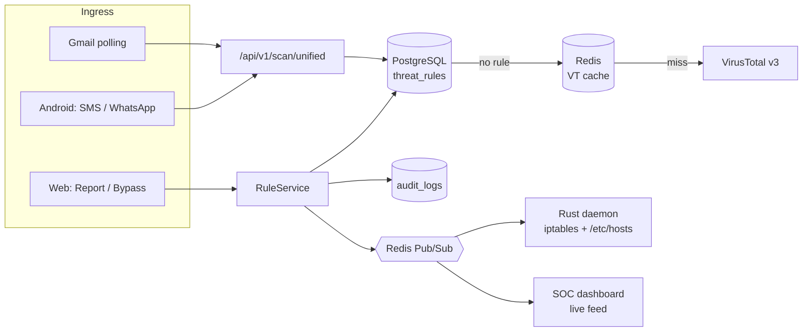

# Obsidian

**One threat-rule engine for email, messaging and the network, for consumers and organizations.**

When someone reports a phishing link from a phone, Obsidian blocks it on every machine in the organization in under a second.

> **Status:** 24-hour hackathon project, in progress. The plan is in [`TODO.md`](TODO.md); the shared API/WebSocket contract is [`docs/protocol.md`](docs/protocol.md). See [Current status](#current-status) for what works today.

---

## Current status

| Component | State |
| --- | --- |
| Repo scaffolding | Done: `db/init.sql`, `docker-compose.yml`, `.env.example`, `docs/protocol.md` (the shared contract), `cloudflared/config.yml`, `scripts/` (seed, VirusTotal pre-warm, demo reset). |
| `backend-spring/` auth | Done: Argon2id password login, passkeys (Spring WebAuthn, JDBC tables), `__Host-session` cookie in Redis, CSRF cookie, mobile bearer tokens, Turnstile. |
| `backend-spring/` rules | Done: `RulePrecedence`; `RuleService` saves, audits and publishes every change; `GET /rules`, `POST /rules/report`, `POST /rules/bypass`. |
| `backend-spring/` scanner | Done: `POST /scan/unified`, `GET /scans`, VirusTotal v3 (Redis cache, 4/min limiter, submit + poll, `PENDING`), topmost `mx.google.com` SPF/DKIM/DMARC, MIME links and attachment SHA-256. |
| `backend-spring/` Gmail | Done: OAuth connect (encrypted refresh token), polling worker, `GET /emails`, `/integrations/gmail`. Not yet tried against a real Google account. |
| `backend-spring/` WebSockets + agents | Done: `/ws/firewall` (bearer handshake, SYNC, BLOCK/BYPASS, HEARTBEAT), `/ws/dashboard`, Redis fan-out, `POST/GET /agents`. |
| `daemon-rust/` | Done: SYNC reconcile, BLOCK/BYPASS, 10 s heartbeat, reconnect, cleanup on SIGINT/SIGTERM, `--dry-run`. Verified end to end in dry-run against the backend; not yet run as root with real iptables. |
| `web-dashboard/` | P0 screens. Works in `live` mode against the backend through the Next.js rewrites (sign-in, rules, live `/ws/dashboard` events). Field names are checked by `ApiContractTest`. |
| `mobile-android/` | Not started: clickable prototype only (`docs/prototype/android.html`). The scan and report API it needs is ready. |

Tests: backend 220/220 (`cd backend-spring && gradle test`, on embedded PostgreSQL 16 and an in-process Redis, so no Docker is needed), daemon 19/19 (`cargo test`).

### What is left
1. **Hour 8 milestone on real hardware:** run the daemon as root (no `--dry-run`), add a domain in the web editor and check that `curl` is blocked, then bypass and check that it works again.
2. **Android app** (P0): biometric lock, notification listener (WhatsApp/SMS), scan and Report. See `docs/protocol.md`; report the link's domain as `DOMAIN` so daemons block it.
3. **Demo setup:** named tunnel + domain, real Turnstile keys, `VT_API_KEY` and `scripts/prewarm-vt.sh`, Gmail OAuth client in Testing mode with test users.
4. **[P1], only after the milestone:** TOTP, heuristic classifier, SIM change detection, `BypassExpiryJob`, TTL picker and audit log view, daemon ACK latency, Code Guard.

---

## Problem Statement

Phishing and scam campaigns don't stick to one channel. The same malicious domain arrives by email, then by SMS, then in a WhatsApp message, and eventually a laptop on the corporate network tries to connect to it. Defenses are still built one channel at a time:

- **The channels don't share what they learn.** An email filter that flags a domain doesn't tell the phone's messaging app, and neither of them tells the network firewall. Whoever spots a threat first can't protect anyone else.
- **Users who spot threats have nowhere to send them.** When a phishing email gets past the filter, the user who notices it usually has no one-click way to report it, and reporting it doesn't protect their colleagues.
- **Consumers are mostly unprotected outside email.** Smishing and WhatsApp scams reach people who have no security team. They are especially effective from unknown numbers, or from familiar contacts whose accounts were compromised.
- **Code is a channel too.** API keys get committed in plain text, vulnerable dependencies ship unnoticed, and a release binary can carry malware. Teams rarely connect these signals to the rest of their defenses.
- **Bypassing a block is all or nothing.** False positives are common. Blocks that are rigid get disabled wholesale, and overrides that never expire stay open forever.
- **Authentication is still often just a password.** The dashboard that controls an organization's firewall should not be protected by a reusable password alone.

**Problem:** Build a platform that treats email, SMS/WhatsApp and network traffic as **one surface with one rule set**. A threat seen once, by any user on any channel, should be blocked everywhere in real time. The platform should stay usable for non-technical consumers, give security teams central control with audit trails, and resist account takeover.

### Who it's for

| | Consumers (B2C) | Organizations (B2B) |
| --- | --- | --- |
| **Who** | Everyday people with an Android phone and a Gmail account | Companies running a small SOC or IT team |
| **Pain** | Scam texts, WhatsApp phishing, spam they can't judge | Per-channel tools, reports that don't spread, unaudited overrides |
| **Need** | Zero-jargon warnings, 1-tap report/trust | One report blocks for everyone, time-limited bypass, OS-level enforcement |

### What success looks like

1. A link reported from a phone is enforced at the OS firewall of an enrolled laptop in **under a second**.
2. Legitimate, cryptographically verified email passes through **untouched**.
3. An unverified verdict is never shown as "safe". Unknown means `PENDING`.
4. Every rule change is **audited**, and enterprise bypasses **expire** automatically.
5. Sign-in uses **passkeys** (FIDO2). Passwords are only a fallback, hashed with Argon2id.

---

## How It Works



1. **Ingest:** messages arrive from Gmail (OAuth polling), Android notifications (SMS and WhatsApp), or the web dashboard.
2. **Decide:** every indicator (URL, domain, IP, sender, file hash) goes through one scan endpoint. The lookup order is org and user rules in PostgreSQL first, then the Redis-cached VirusTotal verdict, then a live VirusTotal lookup.
3. **Act:** reports and bypasses go through a single `RuleService`. It writes the rule, records an audit entry, and publishes the change.
4. **Enforce:** connected Rust daemons apply the change to the OS firewall and DNS sinkhole immediately, and SOC dashboards update live.

---

## Features

### Shared across tiers
- **Unified rule engine.** One blacklist/whitelist covers email senders, phone numbers, URLs, domains, IPs and file hashes, with a fixed precedence order (admin policy → user bypass → user block → org block → global → VirusTotal).
- **Email triage.** "Verified official" requires SPF, DKIM and DMARC to pass **and** the sender domain to be on the allowlist. Links and attachments are scanned through VirusTotal.
- **Report and Bypass everywhere.** Both are one click, on web and mobile.

### Consumer
- **Android app** with a biometric lock (fingerprint, PIN fallback).
- **Real-time SMS and WhatsApp scanning** from notifications. For **saved contacts only links are sent**, and message text never leaves the phone.
- **Personal web portal** for managing your own whitelist and blacklist.

### Enterprise
- **Crowd immunity.** One employee's report blocks the indicator for the whole organization.
- **Rust endpoint daemon (Linux)** that enforces blocks with `iptables` and an `/etc/hosts` sinkhole. It resyncs the full rule set on every reconnect.
- **SOC dashboard** with a live threat feed, agent heartbeat status, and a blacklist/whitelist editor.
- **Time-bound bypasses** with an audit log *(stretch goal)*.
- **Code Guard** *(stretch goal)*. A GitHub App that scans every push and pull request for leaked secrets (gitleaks) and vulnerable dependencies (OSV-Scanner). It also checks every release file against VirusTotal and posts a pass/fail check on the commit. Leaked keys are treated as compromised: Code Guard flags them for rotation and never stores the key itself.

### Security of the platform itself
- Passkeys (WebAuthn/FIDO2) through Spring Security, with an Argon2id password fallback and optional TOTP.
- A host-only `__Host-session` cookie (`Secure`, `HttpOnly`, `SameSite=Lax`) backed by Redis.
- Cloudflare Turnstile on registration and login. Everything is served through a named Cloudflare Tunnel.
- The daemon validates every IP and domain before making any system call, and runs binaries directly, never through a shell.
- Each agent has its own bearer token, and the server stores only its hash.

---

## Tech Stack

| Layer | Technology |
| --- | --- |
| Control plane / API | Java 21, Spring Boot 3.5+ (virtual threads), Spring Security WebAuthn |
| Endpoint agent | Rust 2021, `tokio`, `tokio-tungstenite`, Linux |
| Web app | Next.js 15 (App Router), TypeScript, Tailwind CSS, shadcn/ui |
| Mobile | Kotlin, Jetpack Compose, `BiometricPrompt`, `NotificationListenerService` |
| Data | PostgreSQL 16, Redis 7 (sessions, VirusTotal cache, pub/sub) |
| Edge | Cloudflare named Tunnel, Cloudflare Turnstile |
| Threat intel | VirusTotal API v3 |
| Code scanning | GitHub App (webhooks + Checks API), gitleaks, OSV-Scanner |

---

## Repository Layout

```text
obsidian/
├── backend-spring/     # Spring Boot control plane: auth, rules, scanner, Gmail, WebSockets, Code Guard
├── daemon-rust/        # Linux firewall agent (iptables + /etc/hosts sinkhole)
├── web-dashboard/      # Next.js consumer portal + SOC dashboard
├── mobile-android/     # Kotlin Android app
├── db/init.sql         # PostgreSQL schema
├── docs/protocol.md    # WebSocket + scan API contract
├── cloudflared/        # Named tunnel config
├── scripts/            # Seed data, VirusTotal cache pre-warm, demo reset
└── docker-compose.yml  # PostgreSQL + Redis
```

The full directory map is in [`TODO.md` §3](TODO.md#3-monorepo-directory-structure).

---

## Getting Started

### Prerequisites
- JDK 21+ and Gradle (or `./gradlew`), Node.js 20+, a Rust stable toolchain, Android Studio
- Docker and Docker Compose for the real stack. Tests and `gradle bootTestRun` don't need it.
- A Linux machine for the daemon (root, or `CAP_NET_ADMIN` plus write access to `/etc/hosts`)
- For the demo: a VirusTotal API key, a Google Cloud OAuth client (Gmail API), Cloudflare Turnstile keys, and a domain in Cloudflare for a named tunnel

### Configure
```sh
cp .env.example .env    # fill in the keys; Spring reads ../.env, docker compose reads .env
```

### Run without Docker (development)
```sh
cd backend-spring && gradle bootTestRun                       # :8080, embedded Postgres + Redis, demo seed
cd web-dashboard  && npm install && NEXT_PUBLIC_API_MODE=live npm run dev   # :3000
```
Sign in as `avery.lin@aster.example` (admin), `priya.nair@aster.example` (employee) or `riley.chen@mail.example` (consumer); the password is `obsidian-demo-2026`. Data is lost when the backend stops.

### Run the full stack
```sh
scripts/reset-demo.sh                                  # Postgres + Redis in Docker, schema + seed
cd backend-spring && ./gradlew bootRun                 # :8080
cd web-dashboard  && npm run dev                       # :3000 (NEXT_PUBLIC_API_MODE=live)
VT_API_KEY=... scripts/prewarm-vt.sh                   # cache every demo URL / hash
```

### Enroll a daemon
Register the host on the **Agents** page (or `POST /api/v1/agents`), save the token it shows once to a file readable only by root, then:
```sh
cd daemon-rust && cargo build --release
sudo ./target/release/daemon-rust --server wss://obsidian.<your-domain>/ws/firewall --token-file /etc/obsidian/agent.token
./target/release/daemon-rust --dry-run --token-file agent.token   # no root: prints iptables commands, temp hosts file
```

### Routing
The web app and the API share one origin. `/api`, `/ws`, `/webauthn`, `/login/webauthn`, `/oauth2` and `/login/oauth2` go to Spring (`:8080`), and everything else goes to Next.js (`:3000`). This is set up in `cloudflared/config.yml`, or in `next.config.ts` rewrites in localhost mode.

> Don't use a Cloudflare *quick* tunnel. Its hostname changes on every restart, which breaks passkeys and Turnstile.

---

## API at a Glance

| Endpoint | Purpose |
| --- | --- |
| `POST /api/v1/auth/register` | Create account (Turnstile-verified) |
| `POST /api/v1/auth/login` | Password (+ TOTP) login; returns a cookie on web, a bearer token on mobile |
| `/webauthn/*`, `/login/webauthn` | Passkey registration and login (Spring Security) |
| `POST /api/v1/scan/unified` | Single scan endpoint for all channels |
| `GET /api/v1/rules` | List active blacklist/whitelist rules |
| `POST /api/v1/rules/report` | Blacklist an indicator and broadcast it to daemons |
| `POST /api/v1/rules/bypass` | Whitelist an indicator (optional TTL) and lift the block |
| `POST /api/v1/agents` | Register a daemon; its token is shown once |
| `WS /ws/firewall` | Daemon channel: `SYNC`, `BLOCK`, `BYPASS`, `HEARTBEAT`, `ACK` |
| `WS /ws/dashboard` | Live feed for the SOC dashboard |
| `POST /api/v1/webhooks/github` | Code Guard webhook (signature-verified): push, pull request, release |
| `GET /api/v1/code/findings` | List Code Guard findings for the organization |
| `POST /api/v1/code/findings/{id}/status` | Mark a finding as rotated or a false positive |

The full payloads are in [`TODO.md` §6](TODO.md#6-core-api-specification).

---

## Known Limitations

- **The daemon is Linux only** for now.
- **`/etc/hosts` doesn't cover subdomains**, and browsers using DNS-over-HTTPS ignore it. Known-bad IPs are still dropped by `iptables`.
- **VirusTotal's free tier** allows 4 requests/min and 500/day. Verdicts are cached for 24 hours, crowd reports are checked first, and anything unresolved is shown as `PENDING`.
- **SIM change detection** detects a different SIM in *this* device. It doesn't by itself stop a carrier-side SIM swap.
- **Mobile scanning is links only.** Notifications don't include attachments.
- **Code Guard can't un-leak a key.** Once a key is pushed, clones and forks already have it. Code Guard detects it within seconds and drives rotation, but it can't stop the push on github.com, because blocking a push before it lands requires pre-receive hooks.

---

## Roadmap

- Windows (`netsh`) and macOS (`pfctl`) daemons
- Android DNS/VPN filtering mode
- Device posture checks (SIM, biometrics and heartbeat gating session access)
- Fleet management
- Organization-wide Google Workspace scanning
- Cloudflare WAF rules
- Code Guard extras:
  - Semgrep rules for malicious code
  - Syft/Grype vulnerability scans of release binaries
  - automatic key revocation through provider APIs
  - blocking pushes before they land, on GitHub Enterprise Server or GitLab
  - feeding domains found in malicious code into the firewall rules

---

## Team

| Role | Area |
| --- | --- |
| Dev 1 | Backend: auth, database, Redis, WebSockets, Gmail, Code Guard (stretch) |
| Dev 2 | Threat intel: scanner, VirusTotal, email analysis, Rust daemon |
| Dev 3 | Mobile: Android app, biometrics, message interception |
| Dev 4 | Frontend: login, SOC dashboard, rule editor |
